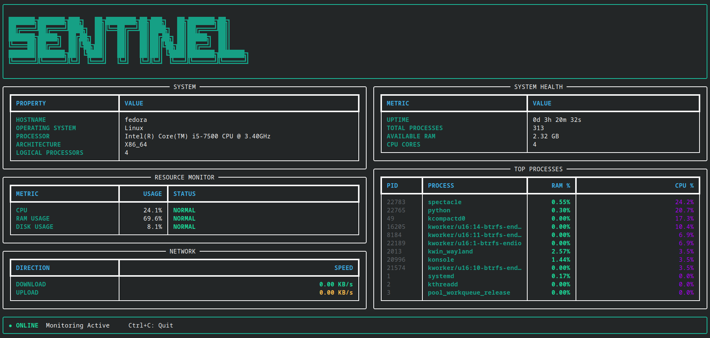

# SENTINEL

SENTINEL is a cross-platform terminal-based system resources and usage monitoring dashboard!

Actually, it shows some of the things in your system like CPU usage, memory, disk usage, network speed, etc.

Actually, this is very cool! 👇



## HOW THIS WAS MADE :D
  
Built using:
- [Python](https://www.python.org/)
- [psutil](https://psutil.readthedocs.io/)
- [py-cpuinfo](https://github.com/workhorsy/py-cpuinfo)
- [Rich](https://rich.readthedocs.io/)

## HOW TO RUN IT :D

You need Python 3 and pip installed in your system.

1. Clone the source code to your device

```sh
git clone https://github.com/Developer-Gaurav96/SENTINEL.git
cd SENTINEL
```

2. Create a virtual environment

```sh
python -m venv .venv
```

3. Activate the virtual environment

Linux / macOS:
```sh
source .venv/bin/activate
```

Windows:
```powershell
.venv\Scripts\activate
```

4. Install the required libraries

```sh
pip install -r requirements.txt
```

5. Run SENTINEL

```sh
python main.py
```

Press `Ctrl+C` to stop the dashboard.

## WHAT I LEARNED

When i was making SENTINEL, i learned how to collect real time system information and data and display it in terminal using python.

I learned to use libraries like psutil and py-cpuinfo to access CPU, memory, disk, network, and process information.

I learned to use the Rich library which allowed me to make organised and more readable terminal interface with tables, panels, colors, and display real-time live updates.

One challenging part was managing the structure of the interface and getting the network speeds and process information to update and display correctly 

Along the way, i improved my understanding of functions, dictionaries, error handling, and working with other external Python libraries. 

I also learned that building a project takes more than just writing code — testing, debugging, and fixing small issues are equally important.

## AI DISCLOSURE

I used ChatGPT during project development to understand basic concepts, debug errors, review my code, and to check possible improvements.

It helped me to understand how different parts of the project work differently together and guided me whenever I got stuck.

I wrote and modified the project code myself, by using AI as a learning and debugging assistant instead of relying on it completely to build the entire project.

